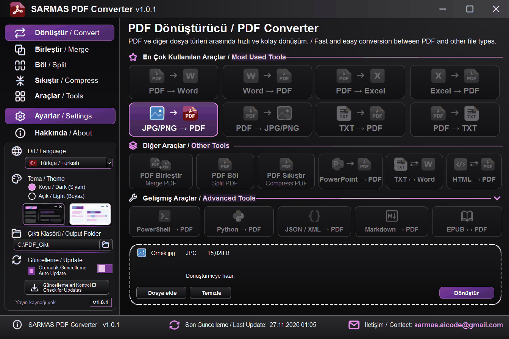

# PDF Converter v1.0.1

Windows ve Linux için ücretsiz, çevrimdışı dosya dönüştürücü. Dosyanızı sürükleyip bırakın veya dosya seçiciden açın. Uygulama dosya türünü tanır ve uygun dönüşüm seçeneklerini gösterir.

## Özellikler

- JPG ve PNG görsellerini PDF’ye dönüştürür. Bu biçimler algılandığında PDF seçeneğini otomatik seçer.
- TXT dosyalarını PDF’ye veya Word belgesine dönüştürür.
- Dosyaları sürükle-bırak ile veya dosya seçiciden açar.
- Dönüştürülen dosyaları seçtiğiniz çıktı klasörüne kaydeder ve klasör tercihinizi hatırlar.
- Dönüşümleri bilgisayarınızda, internet bağlantısı gerektirmeden yapar.

## İlk çalıştırma

- **Windows:** ZIP paketini tamamen ayıklayın. Masaüstü kısayolunu oluşturmak için `Kisayol-Olustur.exe` dosyasını bir kez çalıştırın.
- **Linux:** ZIP paketini tamamen ayıklayın. Ayıklanan klasörde `bash Kisayol-Olustur.sh` komutunu bir kez çalıştırın ve uygulamayı masaüstü kısayolundan açın.

## İletişim

Soru, öneri ve hata bildirimi için [sarmas.aicode@gmail.com](mailto:sarmas.aicode@gmail.com).
